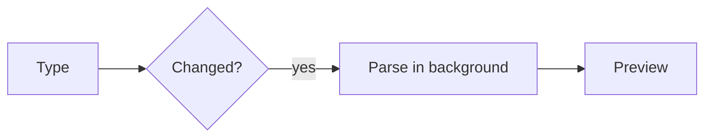

# mde demo

A **fast** Markdown editor with `inline code`, ~~strikethrough~~ and a [link][site].

## Tasks

- [x] Three views
- [ ] Your next idea

| View    | Shortcut |
|---------|----------|
| Editor  | Cmd+1    |
| Split   | Cmd+2    |
| Preview | Cmd+3    |

> Quotes work too, as do footnotes.[^1]

```rust
fn main() {
    println!("Hello, mde");
}
```



[site]: https://commonmark.org
[^1]: This is the footnote.
